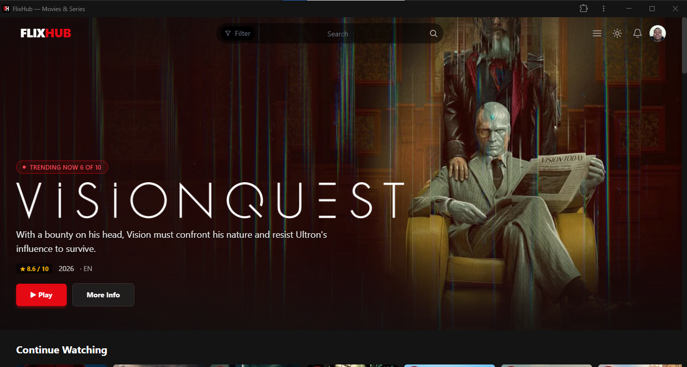
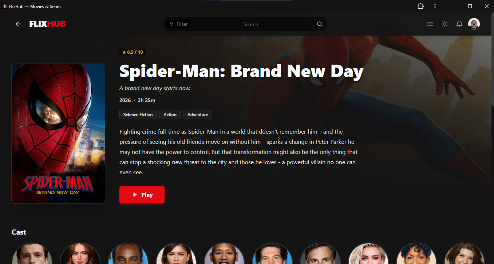
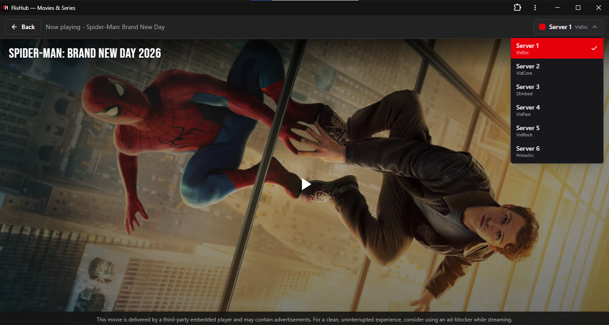
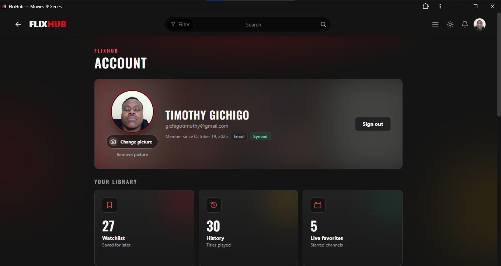

# FlixHub

A Netflix-inspired streaming web application for discovering, browsing, and watching movies and TV shows. Built with React, Vite, and Tailwind CSS, with optional user accounts powered by Supabase.

> **Note:** This project is a user interface and discovery layer. It relies on third-party embed providers and public data APIs (TMDb, IMDb). It does not host or distribute any video content itself.

---

## Screenshots

## Home Page



## Movie detail page



## Watch player with server selector



## Live TV guide/grid view


## Account page




---

## Features

- **Content Discovery** - Browse trending, popular, now-playing, top-rated, and upcoming movies; trending and popular TV shows. Powered by the TMDb API.
- **Unified Search** - Search across movies and TV shows with TMDb. Falls back to IMDb suggestions when TMDb returns no results or encounters an error.
- **Watch Player** - Stream movies and TV episodes through six embed provider servers (VidSrc, VidCore, 2Embed, VidFast, VidRock, PrimeSrc) with a server selector.
- **Live TV** - Browse channels and EPG from a separately deployed backend that caches and parses the iptv-org playlist/XMLTV guides and proxies HLS manifests and segments.
- **Continue Watching** - Automatically tracks watch progress and surfaces unfinished titles at the top of the home page.
- **Watchlist & History** - Save titles into named watchlist collections, filter the watchlist by folder, and keep a chronological watch history (up to 200 entries).
- **Optional Accounts** - Sign in with Google OAuth or email magic link via Supabase. Guest mode works out of the box using localStorage. Library data syncs to the cloud on sign-in and merges with local data.
- **Notifications** - In-app notification bell with a dropdown. Browser push notifications (Web Push) deliver alerts to opted-in subscribed devices. A daily cron job generates relevant notifications based on the user's watch history and watchlist.
- **Progressive Web App** - Service worker provides offline app shell caching and installability on desktop and mobile.
- **Responsive Design** - Desktop navigation with a hamburger menu and a fixed bottom navigation bar on mobile.
- **Dark Theme** - Default Netflix-style dark theme (deep blacks with a red accent) or an optional Cinema theme (deep teal/green with amber accents).

---

## Tech Stack

| Category | Technology |
|----------|-----------|
| Build tool | [Vite](https://vitejs.dev/) |
| UI framework | [React 18](https://react.dev/) |
| Routing | [React Router DOM v7](https://reactrouter.com/) |
| Styling | [Tailwind CSS 4](https://tailwindcss.com/) |
| Authentication | [Supabase Auth](https://supabase.com/docs/guides/auth) |
| Database | [Supabase](https://supabase.com/) (PostgreSQL) |
| Realtime | [Supabase Realtime](https://supabase.com/docs/guides/realtime) |
| Video player | [Vidstack React](https://www.vidstack.dev/) + [hls.js](https://github.com/video-dev/hls.js) |
| Push notifications | [web-push](https://github.com/web-push-codelab/web-push) |
| Analytics | [@vercel/analytics](https://vercel.com/docs/concepts/monitoring/analytics) |
| Content data | [TMDb API](https://developer.themoviedb.org/) (v3) |
| IMDb fallback | [IMDb public suggestion endpoint](https://v3.sg.media-imdb.com/) |
| Live TV sources | [iptv-org](https://github.com/iptv-org/iptv) playlist + XMLTV EPG |
| Live TV backend | [Render](https://render.com/) |
| Deployment | [Vercel](https://vercel.com/) (frontend) |

---

## Project Structure

```
flixhub/
  live-tv-backend/           # Separate Render service for Live TV
    src/
      parsers.js             # Server-side M3U/XMLTV parsing
      server.js              # Cached channel/EPG API + signed HLS proxy
    test/
      parsers.test.js
  api/                      # Vercel serverless functions
    _lib/
      push.mjs              # Shared Web Push + Supabase admin helpers
    cron/
      notifications.mjs     # Daily cron: generate and send notifications
    delete-account.mjs      # POST /api/delete-account -- account deletion
    push.mjs                # GET /api/push (VAPID public key), POST (send push)
    stream.mjs              # Legacy Vercel HLS proxy
    proxy.mjs               # Legacy Vercel live stream proxy
    imdb-search.mjs         # IMDb suggestion endpoint proxy
  public/                   # Static assets
    favicon.svg
    manifest.webmanifest    # PWA manifest
    sw.js                   # Service worker (offline shell + push handler)
    icons/
    logos/
  scripts/
    generate-icons.mjs      # PWA icon generation
    verify-icons.mjs        # Icon validation
  src/
    components/             # UI components (Navbar, Hero, VideoPlayer, etc.)
    context/                # React contexts (AuthContext, NotificationsContext)
    data/
      movies.js             # Static seed data for the UI shell
    hooks/
      useEmbedServer.js     # Embed server selection logic
      useLibrary.jsx        # Hybrid localStorage + Supabase library hook
      useMovieData.js       # Data fetching hook with loading/error states
    pages/                  # Route page components
    services/               # API and service layers
      authService.js        # Google OAuth + email magic link
      avatarService.js      # Avatar upload via Supabase Storage
      cloudLibrary.js       # Supabase library read/write adapter
      imdbService.js        # IMDb search with localStorage caching
      libraryService.js     # localStorage library persistence
      liveTvService.js      # Client for the Live TV backend
      mergeLibrary.js       # Guest-to-cloud data merge on sign-in
      notificationService.js # In-app + push notification logic
      searchService.js      # Unified TMDb + IMDb search
      scrollMem.js          # Session-scoped scroll position memory
      seasonMem.js          # Per-series season + watched-episode memory
      servers.js            # Embed provider URL configurations
      supabaseClient.js     # Supabase client singleton (optional)
      tmdbService.js        # TMDb API service layer
    index.css               # Tailwind base + theme variables
    main.jsx                # React entry point
    App.jsx                 # Root component with routing
  supabase/
    schema.sql              # Database schema (profiles, watchlist, history, etc.)
    collections-migration.sql # Add collections to an existing Supabase project
  docs/                     # Documentation
  index.html
  vercel.json               # Vercel deployment config
  vite.config.js            # Vite config (dev API shim for /api/*)
  package.json
  .env.example
  .gitignore
```

---

## Prerequisites

- **Node.js** 18.14 or newer (LTS recommended)
- **npm** (comes with Node.js)
- A **TMDb API key** (free) -- required for content discovery
- A **Supabase project** -- required only for user accounts, library sync, and notifications (optional; the app works in guest mode without it)
- A **Vercel account** -- required only for push notifications and the daily cron (optional; the app works fully locally without it)

---

## Setup & Installation

1. **Clone the repository:**

   ```sh
   git clone https://github.com/Timo-Gich/FlixHub.git
   cd FlixHub
   ```

2. **Install dependencies:**

   ```sh
   npm install
   ```

3. **Configure environment variables:**

   ```sh
   cp .env.example .env
   ```

   Edit `.env` and add your TMDb API key. See [Environment Variables](#environment-variables) below for the full list, including optional Supabase/VAPID keys.

4. **Start the development server:**

   ```sh
   npm run dev
   ```

   Open http://localhost:5173 in your browser.

   The Vite dev server includes a built-in shim (`vite.config.js`) that executes serverless functions in `api/*.mjs` locally, so API routes like `/api/imdb-search`, `/api/stream`, and `/api/proxy` are available during development without a Vercel deployment.

---

## Environment Variables

All variables are defined in `.env` (copy from `.env.example`).

### Required

| Variable | Description |
|----------|-------------|
| `TMDB_API_KEY` | TMDb API v3 key. Get one at [TMDb Settings > API](https://www.themoviedb.org/settings/api). |

### Optional (accounts + cloud library)

| Variable | Description |
|----------|-------------|
| `VITE_SUPABASE_URL` | Your Supabase project URL. |
| `VITE_SUPABASE_ANON_KEY` | Your Supabase anon (public) key. |

When both are set, the app switches from guest mode to signed-in mode. When either is missing, the app runs in guest-only mode using localStorage.

For a new Supabase project, run [`supabase/schema.sql`](./supabase/schema.sql) in the SQL Editor. To add Collections to an existing project, run [`supabase/collections-migration.sql`](./supabase/collections-migration.sql) first; it adds owner-only RLS and enables collection realtime events.

### Server-side (push notifications)

These are read by the `api/` serverless functions on Vercel and must be configured as **server environment variables** (never expose `SUPABASE_SERVICE_ROLE_KEY` or private VAPID keys with a `VITE_` prefix).

| Variable | Description |
|----------|-------------|
| `SUPABASE_URL` | Supabase project URL (server-side alias). |
| `SUPABASE_ANON_KEY` | Supabase anon key (server-side alias). |
| `SUPABASE_SERVICE_ROLE_KEY` | Supabase service role key for admin operations. |
| `VAPID_PUBLIC_KEY` | Web Push public key. Generate with `npx web-push generate-vapid-keys`. |
| `VAPID_PRIVATE_KEY` | Web Push private key (keep secret). |
| `VAPID_SUBJECT` | VAPID subject (e.g., `mailto:you@example.com`). |
| `CRON_SECRET` | Shared secret for protecting the daily notification cron endpoint. |

### Vite env prefix

The Vite config whitelists both `VITE_` and non-prefixed env names, so either `VITE_SUPABASE_*` or `SUPABASE_*` works for local development. On Vercel, configure server variables through the Project Settings.

---

## Available Scripts

| Command | Description |
|---------|-------------|
| `npm run dev` | Start the Vite development server at `http://localhost:5173`. |
| `npm run build` | Build the production bundle with Vite. |
| `npm run preview` | Preview the production build locally. |

---

## Deployment

### Live TV backend (Render)

The root `render.yaml` deploys the standalone service in `live-tv-backend/`.
Create the Render service from this repository's blueprint, then set
`FRONTEND_ORIGINS` to the frontend's Vercel origin (comma-separated for
multiple origins). Render generates `STREAM_SIGNING_SECRET` for signed HLS
resource URLs.

Set `VITE_LIVE_TV_API_URL` in the Vercel project to the Render service URL
(for example `https://flixhub-live-tv.onrender.com`) and redeploy the frontend.
For local development, start `npm --prefix live-tv-backend start` on port 3001
and run `npm run dev`; Vite proxies Live TV API requests to the local backend.

### Vercel (recommended)

The project includes a `vercel.json` with three concerns:

1. **SPA fallback** - All non-API routes rewrite to `/index.html` so client-side routing works.
2. **API passthrough** - `/api/*` routes are served by the serverless functions in the `api/` directory.
3. **Daily cron** - A Vercel Cron Job runs `/api/cron/notifications` every day at 09:00 UTC to generate and send notifications.

```sh
# Install the Vercel CLI if you haven't already
npm install -g vercel
vercel
```

After deploying, add all environment variables (both client and server) in the Vercel Project Settings under **Environment Variables**.

### Other static hosts

The built output is a standard static site. Ensure your host is configured with a **SPA fallback** (all unknown routes serve `index.html`) so React Router works on direct navigation. Server-side features (push notifications, cron) require Vercel or an equivalent serverless platform.

---

## Architecture

### Guest-first design

The app is usable without any backend. On launch it checks for Supabase environment variables:

- **Configured**: Users can sign in via Google OAuth or email magic link. Library data (watchlist, history, favorites) syncs to Supabase and merges with local data on first sign-in.
- **Not configured**: The app runs entirely from localStorage. All library features work, but data is tied to the browser.

The Supabase client is lazily initialized, and every service layer no-ops gracefully when it is unavailable.

### Data flow

```
UI components (pages)
        |
        v
  Service layers  <--->  TMDb / IMDb / iptv-org / public APIs
        |
        v
Supabase (optional) <--->  Serverless functions (api/)
        |
        v
  localStorage (guest fallback)
```

### Routing

Client-side routing via React Router DOM v7. The router is configured in `src/App.jsx`. Key routes include:

| Route | Description |
|-------|-------------|
| `/` | Home -- hero carousel, Continue Watching row, trending/popular rows |
| `/watch/:id` | Movie player with server selector |
| `/movie/:id` | Movie detail page |
| `/tv/:id` | TV series detail page |
| `/watch/tv/:id/:season/:episode` | TV episode player |
| `/search` | Search results (TMDb + IMDb fallback) |
| `/live` | Live TV browser (guide and grid views) |
| `/live/:channelId` | Live channel player |
| `/watch-later`, `/watchlist` | Watchlist page |
| `/history` | Watch history page |
| `/new-popular` | New and popular content |
| `/login` | Sign in page |
| `/account` | Account page (profile, avatar, notifications) |
| `/about`, `/careers`, `/press`, `/investors`, `/terms`, `/privacy`, `/cookies`, `/legal`, `/accessibility` | Static info pages |

### Styling and theming

The app uses a custom Tailwind CSS dark theme defined via CSS variables in `src/index.css`. Two themes are available:

- **Netflix (default)** -- deep black backgrounds with a red accent (`#e50914`).
- **Cinema** -- deep teal/emerald backgrounds with amber accents, applied by setting `data-theme="cinema"` on the `<html>` element (toggled from the Navbar).

Typography uses Inter for body text and Oswald for display headings (loaded via Google Fonts in `index.html`).

### Service worker (PWA)

The PWA service worker (`public/sw.js`) implements a cache-first strategy for the app shell (HTML, CSS, JS, icons) with background revalidation. Media playback, API routes, and Range requests always bypass the cache to ensure live content is fresh. The service worker also handles Web Push messages and notification clicks.

### Notifications system

The notification pipeline has three moving parts:

1. **In-app** -- A React context (`NotificationsContext`) subscribes to Supabase Realtime changes on the `notifications` table. The notification bell in the Navbar shows unread counts and a dropdown with recent items.
2. **Browser push** -- The user can opt in to Web Push via the Account page. The browser subscription is stored in a `push_subscriptions` table. The daily cron generates notifications and sends pushes to subscribed devices via the `/api/push` endpoint.
3. **Daily cron** (`/api/cron/notifications`) -- Runs at 09:00 UTC on Vercel. For each opted-in user, it generates relevant notifications based on trending titles that match the user's watching patterns, release alerts for recent episodes of followed shows, release alerts for watchlisted upcoming movies, and "Continue watching" reminders. Notifications are deduplicated by key and expire after 30 days. The cron is protected by a `CRON_SECRET` checked via bearer token.

### Live TV

The Render service downloads and parses the iptv-org M3U playlist and XMLTV guides,
then caches the results. The frontend receives channel metadata and only the
requested programmes for the visible channels/time range. HLS manifests and
segments are streamed through signed backend URLs, with upstream retries and
range forwarding handled by the service rather than direct browser requests.

### Embed servers

The watch player uses iframe embeds from six third-party providers. The server selector persists the user's preference in localStorage. All providers accept TMDb IDs directly, so no IMDb ID lookup is needed.

---

## Development Notes

- **Theme toggle** -- The Navbar includes a theme toggle. The selected theme is persisted in `localStorage` under the key `flixhub-theme` and applied before first paint (via an inline script in `index.html`) to prevent flash.
- **Scroll restoration** -- Session-scoped scroll positions are saved per route in `sessionStorage`. Full-screen player routes are excluded.
- **Season memory** -- The last-viewed season for a series is remembered in `localStorage` so navigating back from the player returns to the right season.
- **Episode tracking** -- A lightweight per-series map in `localStorage` tracks which episodes have been watched, so the series detail page can show checkmarks even though the cloud history only stores the most recent episode.
- **Scroll arrows on rows** -- Horizontal card rows show scroll buttons only when there is content to scroll in that direction.
- **Service worker** -- Registered automatically on load. It never intercepts `/api/*`, media files, Range requests, or third-party resources.
- **Watch progress** -- Progress is tracked in 5-second intervals and only ever increases, preventing quick visits or backward scrubbing from reducing recorded progress. A title is considered "finished" at 98% of its duration.
- **Library sync** -- On first sign-in, local library data (watchlist, history, favorites) is merged with cloud data. Conflicts resolve by newest timestamp; progress values keep the maximum. A merge flag in `sessionStorage` prevents re-merging on session restarts.
- **Realtime subscriptions** -- The library hook maintains a shared Supabase Realtime channel per user (deduplicated across all mounted components) to propagate watchlist, collection, and other library changes without duplicate channel subscriptions.

---

## License

This project is provided as-is for educational and personal use. It relies on third-party APIs and embed providers whose terms of service apply. Always comply with applicable laws regarding content access and distribution.